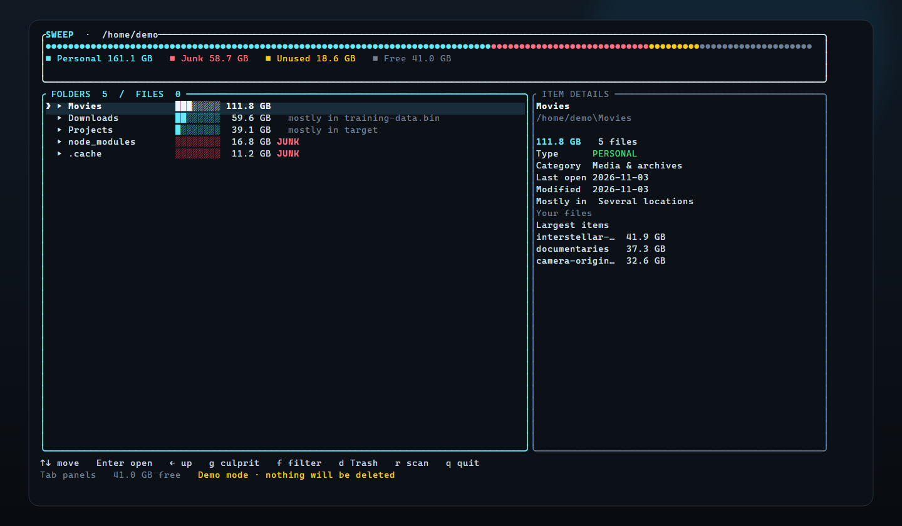

<div align="center">

# sweep

### See what is filling your disks. Clean up with confidence.

Fast, keyboard-first disk space analysis for Windows and Linux.

[](https://github.com/PavelCRG/sweep/actions/workflows/ci.yml)
[](https://github.com/PavelCRG/sweep/releases/tag/v0.1.0)
[](#install)

</div>

<p align="center">
  
</p>

Sweep scans mounted disks or selected folders, makes the biggest space users easy to find, and sends reviewed items to your system Trash. The demo mode shows the full interface without touching your files.

## Install

Download the archive for your system from the [v0.1.0 release](https://github.com/PavelCRG/sweep/releases/tag/v0.1.0), extract it, and run `sweep` (or `sweep.exe` on Windows). Each release includes a SHA-256 checksum file.

Or build the standalone binary from source with Rust installed:

```sh
cargo build --release --locked
```

The binary is at `target/release/sweep` on Linux and `target/release/sweep.exe` on Windows.

## Quick start

```sh
sweep                         # scan mounted disks and open the TUI
sweep --path ~/Projects       # scan a folder
sweep --path C:\Users\Pavel  # scan a Windows folder
sweep --demo                  # explore a safe virtual disk
sweep --plain                 # print a readable report
sweep --json > before.json    # save a snapshot
sweep --compare before.json   # compare a new scan with that snapshot
sweep --csv > report.csv      # export a spreadsheet-friendly report
sweep --check-updates         # check for a release when you choose
```

Scans and reports run locally. Sweep connects to GitHub only when you explicitly run `--check-updates`; no scan data is sent.

## Explore the TUI

| Key | Action |
| --- | --- |
| `↑` / `↓` or `j` / `k` | Move through the list |
| `Enter` / `→` | Open a folder or disk |
| `Esc` / `←` | Go up; cancel a rescan |
| `g` | Jump into the largest space-using child |
| `f` | Show everything or only Junk and Unused |
| `d` twice | Move the selected item to Trash |
| `r` | Rescan the selected disks |
| `Tab` | Switch panel focus |
| `q` | Quit |

`Ctrl+C` cancels the initial scan. Unreadable or locked entries are skipped and counted.

## Safe cleanup

Sweep explains its `JUNK`, `UNUSED`, and `SYSTEM` labels. Review the item and its size, then press `d` twice to move it to the operating system's Trash. Protected system paths are blocked. Use `--dry-run` to preview cleanup without changing files; `--demo` is always non-destructive.

## Reports

JSON snapshots can be compared later with `--compare`. Comparisons match paths and show size changes, including added and removed files. CSV exports include paths, sizes, tags, categories, and label reasons.

## Build and verify

```sh
cargo fmt --all -- --check
cargo test --locked
cargo build --release --locked
```

GitHub Actions checks Windows and Linux builds. Version tags such as `v0.1.0` produce standalone archives and SHA-256 checksums.

## Project

Created and maintained by [PavelCRG](https://github.com/PavelCRG). Bug reports and contributions are welcome in [Issues](https://github.com/PavelCRG/sweep/issues).
